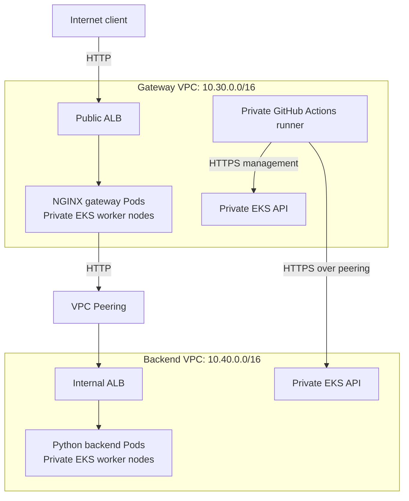

# Sentinel Split Architecture

An AWS proof of concept that exposes a public gateway while keeping the backend application and both Kubernetes management APIs private.

The gateway runs NGINX on one EKS cluster. It forwards requests over VPC Peering to an internal Application Load Balancer serving a Python backend on a separate EKS cluster.

A successful request to the public gateway returns:

```text
Hello from backend
```

## Project status

The infrastructure and applications have been deployed successfully.

Verified capabilities include:

- Two VPCs connected through VPC Peering.
- Two EKS clusters with private API endpoints.
- Private worker nodes distributed across two Availability Zones.
- A private self-hosted GitHub Actions runner.
- A public gateway ALB and an internal backend ALB.
- Successful public requests through the gateway to the backend.
- Successful gateway-cluster Pod access to the internal backend ALB.
- Direct backend access attempts from a local computer and the runner timing out.
- Terraform formatting, validation and recursive TFLint checks.
- Automated application build, container tests, ECR publication and deployment by image digest.

This is a learning and demonstration environment, not a production-ready platform.

## Architecture



Each VPC also has an Internet Gateway and one NAT Gateway. NAT provides outbound internet access for private resources; application traffic between the VPCs uses peering.

## Request flow

1. A client sends an HTTP request to the public gateway ALB.
2. The ALB forwards the request to a gateway Pod.
3. NGINX proxies the request to the internal backend ALB.
4. The request crosses VPC Peering using private addresses.
5. The internal ALB forwards the request to a backend Pod.
6. The backend response returns through NGINX and the public ALB.

Both application Services use `ClusterIP`. Cross-cluster communication uses the internal ALB hostname, not a Kubernetes Service IP.

## Network layout

Region: `eu-north-1`

Availability Zones: `eu-north-1a` and `eu-north-1b`

| Domain | VPC CIDR | Private subnets | Public subnets |
|---|---|---|---|
| Gateway | `10.30.0.0/16` | `10.30.11.0/24`, `10.30.12.0/24` | `10.30.1.0/24`, `10.30.2.0/24` |
| Backend | `10.40.0.0/16` | `10.40.11.0/24`, `10.40.12.0/24` | `10.40.1.0/24`, `10.40.2.0/24` |

- EKS worker nodes and the runner have no public IP addresses.
- Both EKS API endpoints are private.
- Public subnets provide placement for NAT Gateways and internet-facing load balancers.
- The backend ALB uses private subnets.
- Private route tables contain routes to the other VPC through peering.
- Each VPC has one NAT Gateway shared by its private subnets.

## Repository structure

| Path | Purpose |
|---|---|
| Root Terraform files | Compose infrastructure modules, access policies and security rules |
| `modules/networking/` | VPCs, subnets, routing, Internet Gateways and NAT Gateways |
| `modules/peering/` | VPC Peering and private routes |
| `modules/eks/` | EKS clusters, worker groups, add-ons and workload IAM identities |
| `modules/runner-iam/` | Runner IAM role and instance profile |
| `modules/runner/` | Private runner EC2 instance and security group |
| `modules/registry/` | ECR repositories |
| `apps/backend/` | Python backend and Dockerfile |
| `apps/gateway/` | NGINX gateway configuration and Dockerfile |
| `k8s/backend/` | Backend Deployment, Service and Ingress |
| `k8s/gateway/` | Gateway Deployment, Service and Ingress |
| `.github/workflows/` | Validation, bootstrap, infrastructure and application workflows |
| `scripts/` | Runner tooling installation |
| `docs/design.md` | Architecture decisions and trade-offs |
| `docs/evidence/` | Deployment and connectivity screenshots |

## Infrastructure deployment

Terraform apply runs exclusively through GitHub Actions.

The infrastructure deployment workflow:

1. Checks formatting.
2. Initializes the remote state backend.
3. Validates the configuration.
4. Creates a saved Terraform plan.
5. Applies that saved plan.
6. Displays outputs and removes the local plan file.

Terraform state is stored in an S3 bucket with:

- Encryption.
- Versioning.
- Public access blocked.
- Non-TLS access denied.
- S3 lock-file locking.

The state bucket is created by a separate bootstrap workflow and is not managed by the main Terraform configuration.

Pull requests and pushes also run formatting checks, validation without the remote backend, and recursive TFLint checks. TFLint currently uses its built-in Terraform rules; an AWS-specific ruleset has not been configured.

## Application CI/CD

The application workflows are:

- `build-backend.yml`: Build and deploy backend.
- `build-gateway.yml`: Build and deploy gateway.

Each workflow runs on the private self-hosted runner after relevant changes reach `main`, or through manual dispatch.

### Backend pipeline

1. Verifies the runner's AWS identity.
2. Builds a Docker image.
3. Tests health, the expected response and an unknown route.
4. Publishes the image to ECR using a unique immutable tag.
5. Retrieves its SHA-256 digest.
6. Uses Kustomize to render deployment manifests with that digest.
7. Validates the rendered manifests against the Kubernetes API.
8. Applies the manifests and waits for rollout.
9. Confirms that the Deployment references the published image digest.
10. Removes temporary credentials and deployment files.

### Gateway pipeline

The gateway pipeline follows the same build-and-deploy sequence.

Before testing, it reads the backend Deployment's image reference from `eks-backend`. It uses that digest-pinned image in an isolated Docker network to verify:

- Gateway health.
- Proxying the backend response.
- Forwarding the backend's HTTP 404 response.

These container integration tests are separate from live end-to-end connectivity checks.

The image references in the checked-in application manifests are baseline values. The pipelines replace them in temporary rendered manifests without committing a new digest to Git.

### Current CI/CD limits

- Application build and integration tests run after merge to `main`.
- Current PR checks cover Terraform; they do not validate all workflow YAML or build application images.
- Backend and gateway releases are independent.
- A backend release does not automatically trigger gateway integration tests.
- Failed rollouts fail the workflow; automatic rollback is not configured.
- Historical workflow reruns are not prevented from deploying an older application revision.
- Git does not contain a separate promotion commit recording every deployed digest; workflow summaries record the published and deployed references.

## Authentication and permissions

### Infrastructure bootstrap

The GitHub-hosted Terraform workflow uses short-lived AWS session credentials stored in the GitHub Environment named `bootstrap`:

- `AWS_ACCESS_KEY_ID`
- `AWS_SECRET_ACCESS_KEY`
- `AWS_SESSION_TOKEN`

Credentials are never committed to Git. When a session expires, the environment secrets must be refreshed before rerunning the failed infrastructure workflow.

GitHub OIDC federation was not configured because IAM OIDC provider operations were denied by an organization SCP. The restriction was respected.

### Private runner

Application workflows use the runner's EC2 instance role. They do not use the bootstrap AWS secrets.

The runner has:

- Systems Manager access for administration.
- Permission to describe the two EKS clusters.
- Scoped ECR image push and pull permissions.
- EKS view access.
- EKS edit access scoped to the `default` namespace.

The runner does not have permanent EKS cluster-admin access.

### Workload identities

EKS Pod Identity provides separate IAM roles for:

- The VPC CNI.
- The AWS Load Balancer Controller.

The CNI policy was removed from the node roles after Pod Identity credential retrieval was verified.

A temporary installation role was used for the controller's cluster-scoped resources. Its EKS access and runner assume-role permission were removed after installation.

Reinstalling or upgrading controllers through that workflow requires explicitly re-enabling the temporary access in Terraform and removing it again afterwards.

## Security controls

- Private EKS API endpoints.
- Private EC2 instances without SSH keys or inbound SSH rules.
- Systems Manager administration of the runner.
- Backend ALB HTTP ingress restricted to the gateway cluster security group.
- Backend ALB egress restricted to the backend cluster security group on the application port.
- Separate IAM identities for nodes, the runner and AWS-integrated workloads.
- Namespace-scoped application deployment permissions.
- Digest-pinned deployed application images.
- Non-root application containers.
- Read-only root filesystems in Kubernetes.
- Linux capabilities dropped and privilege escalation disabled.
- Application service-account token automount disabled.
- CPU and memory requests and limits.
- Readiness and liveness probes.

The backend ALB rule trusts the gateway cluster security group, not an individual application identity. It does not establish per-Pod isolation.

Kubernetes NetworkPolicy has not been configured or validated.

## Validation

Evidence and explanations are available in [docs/evidence/README.md](docs/evidence/README.md).

| Check | Observed result | What it demonstrates |
|---|---|---|
| Backend deployment | Successful rollout | Backend replicas became available |
| Gateway deployment | Successful rollout | Gateway replicas became available |
| Gateway-cluster test Pod to internal backend ALB | `Hello from backend` | Private application connectivity between the VPCs |
| Local computer to public gateway ALB | `Hello from backend` | Successful end-to-end application request |
| Browser to public gateway ALB | `Hello from backend` | Public browser access through the gateway |
| Local computer to internal backend ALB | Connection timeout | Direct access failed from that tested source |
| Runner host to internal backend ALB | Connection timeout | Direct access failed from the runner |

A timeout alone does not identify the blocking network control. The negative tests are interpreted alongside the configured routes and security groups.

These checks do not prove security against every source, availability during an AZ failure, or capacity under load.

### Repeat the public check

Retrieve the current public ALB hostname from the runner:

```bash
kubectl --context sentinel-gateway -n default get ingress sentinel-gateway
```

From a local computer:

```powershell
curl.exe --fail-with-body --connect-timeout 5 --max-time 20 http://<public-alb-hostname>/
```

Expected response:

```text
Hello from backend
```

The gateway `/healthz` endpoint checks gateway health locally. It does not verify backend connectivity; use `/` for the end-to-end check.

## Setup and reproduction

This repository contains a deployed lab configuration, not a one-command portable installation.

Prerequisites include:

- An AWS account with the required permissions.
- GitHub Actions and repository access.
- Terraform and AWS CLI for preparation and diagnostics.
- An AWS bootstrap session.
- Network and address-space planning.
- A GitHub Environment named `bootstrap`.

Deployment order:

1. Review account, region, CIDRs, role names and hardcoded resource references.
2. Create and protect the S3 state bucket with the bootstrap workflow.
3. Configure the Terraform backend and bootstrap environment secrets.
4. Deploy infrastructure through GitHub Actions in stages.
5. Register the private runner with GitHub and install its system service.
6. Install and verify the runner tooling.
7. Verify private API connectivity and EKS access.
8. Temporarily enable controller installation access.
9. Install the AWS Load Balancer Controller in both clusters.
10. Remove the temporary installation access.
11. Build and deploy the backend.
12. Update the gateway's backend URL using the internal ALB hostname.
13. Build and deploy the gateway.
14. Repeat positive and negative connectivity checks.

Runner registration was performed manually. Its registration is not recreated automatically by Terraform.

A new environment requires updating account-specific values, subnet IDs, security-group references and the backend ALB hostname. ALB names can change when Ingress resources are recreated.

## Trade-offs and limitations

| Decision | Benefit | Cost or limitation |
|---|---|---|
| Separate VPCs and EKS clusters | Clear network and management boundaries | Higher cost and operational complexity |
| VPC Peering | Simple private connectivity for two VPCs | Requires routing management; peering is non-transitive |
| One NAT Gateway per VPC | Lower cost than one per AZ | Shared outbound dependency on one AZ |
| Two workers and two application replicas per cluster | Replicas can run on separate nodes | Does not prove availability during every failure |
| `t3.small` workers and a `t3.micro` runner | Lower lab cost | Limited resources for larger builds and workloads |
| Internal ALB between clusters | Stable service entry point independent of Pod IPs | Additional cost and load-balancer dependency |
| EC2 role for private automation | No copied AWS keys in application workflows | The persistent runner is a trusted security component |
| Temporary bootstrap credentials | Works within observed account restrictions | Manual refresh required |
| Temporary controller administrator | Removes permanent broad installation privileges | Upgrades require a controlled access-enablement step |
| HTTP demonstration | Simple functional validation | Traffic is not encrypted with TLS |
| Runtime digest rendering | Deploys the exact tested image | Base manifest digest does not track the latest release |

Additional production improvements would include:

- TLS and appropriate certificate management.
- Application authentication and authorization.
- Stronger workload isolation and validated NetworkPolicies.
- PR checks for workflows, manifests and application builds.
- A reviewed release and rollback strategy.
- Automated configuration discovery for recreated environments.
- Monitoring, alerting and log retention.
- Load testing and controlled failure testing.
- Image vulnerability review and supply-chain hardening.
- Review and reduction of controller IAM permissions where appropriate.

## Cost and teardown

EKS clusters, worker instances, NAT Gateways, ALBs, storage and other resources can continue incurring charges while the environment is idle.

Closing a terminal, browser or SSM session does not stop the environment.

An automated teardown workflow has not yet been implemented. The intended teardown order is:

1. Stop new application and infrastructure deployment runs.
2. Delete application Ingress resources while the controllers and worker nodes are still running.
3. Verify that their ALBs, target groups and controller-managed dependencies have been removed.
4. Remove remaining application resources.
5. Run Terraform destroy through a dedicated GitHub Actions workflow.
6. Verify that project infrastructure has been removed.
7. Remove the runner registration from GitHub.
8. Retain or delete the bootstrap state bucket separately according to the chosen state-retention policy.

Do not destroy the controllers or clusters before cleaning up their load balancers.

The lab ECR repositories are configured to allow deletion while containing images. This choice is intended for lab cleanup and should be reviewed before production use.

## Further documentation

- [Architecture decisions](docs/design.md)
- [Validation evidence](docs/evidence/README.md)