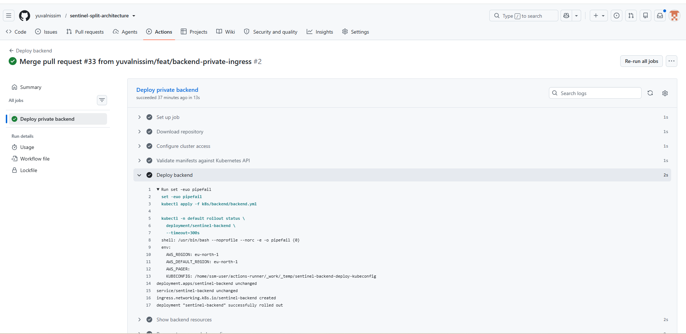
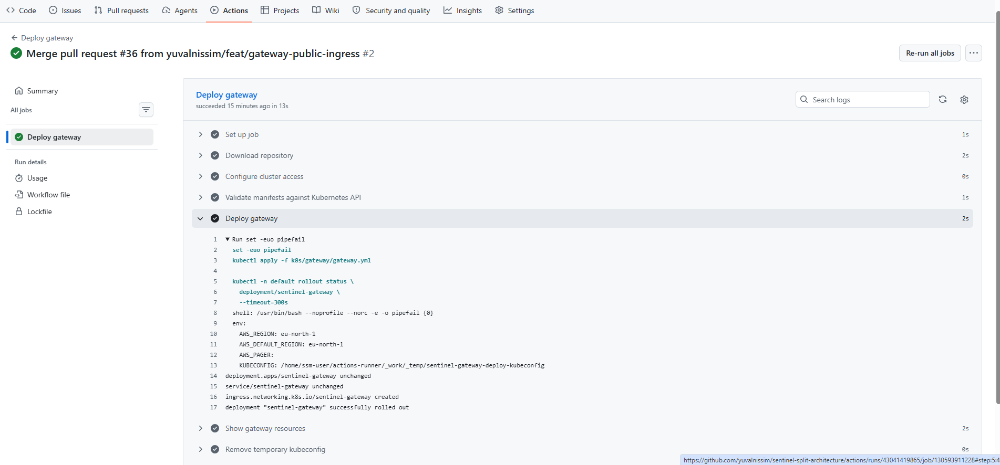
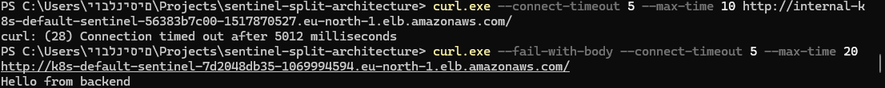
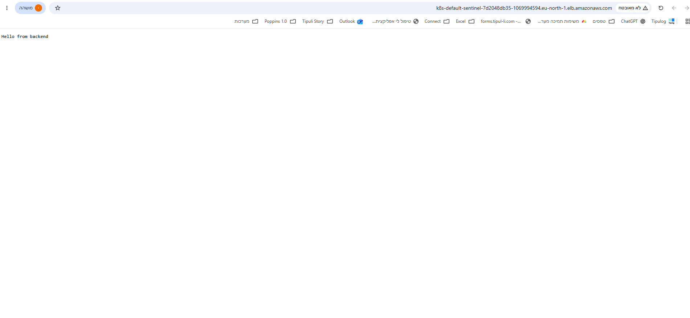
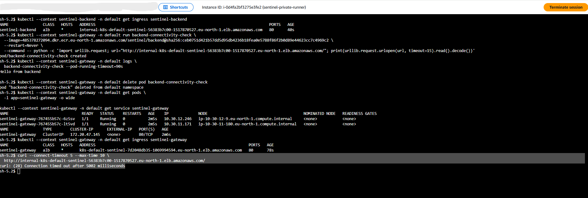

# Deployment and connectivity evidence

These screenshots document the deployment and connectivity checks performed on 11 November 2026.

## Backend deployment

GitHub Actions applied the backend manifests, created the Ingress, and confirmed that the backend Deployment successfully rolled out.

## Gateway deployment

GitHub Actions applied the gateway manifests, created the Ingress, and confirmed that the gateway Deployment successfully rolled out.

## Access from a local computer

A direct HTTP request from the local computer to the internal backend ALB timed out.

A request to the public gateway ALB returned `Hello from backend`, demonstrating a successful request through the gateway to the backend.

## Browser access

Opening the public gateway ALB address in a browser returned `Hello from backend`.

This demonstration uses HTTP. TLS has not been configured.

## Gateway connectivity and runner restriction

A temporary test Pod in the gateway cluster successfully requested the internal backend ALB and received `Hello from backend`. The test Pod was then deleted.

A direct request from the runner host to the same internal ALB timed out.

Together with the configured security group rules, these results support the intended separation between permitted gateway traffic and runner traffic. A timeout alone does not identify which network control blocked a request.

## Scope

These checks demonstrate successful deployments, end-to-end HTTP connectivity, and failed direct access attempts from the tested sources.

They do not establish comprehensive security, load capacity, or availability during infrastructure failures.

## Environment teardown

The `Destroy Sentinel environment` workflow completed successfully on
12 November 2026 and verified that Terraform state contained no managed
resources.

Follow-up AWS checks returned no EKS clusters in eu-north-1, neither
project VPC, and no active project-tagged EC2 instances.

The separately bootstrapped S3 state bucket was subsequently emptied
and deleted. The application endpoints shown above are no longer active.